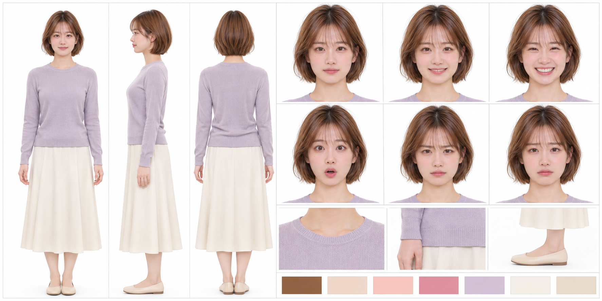
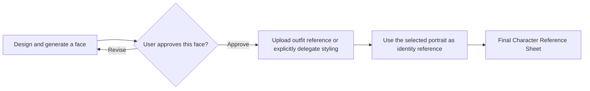
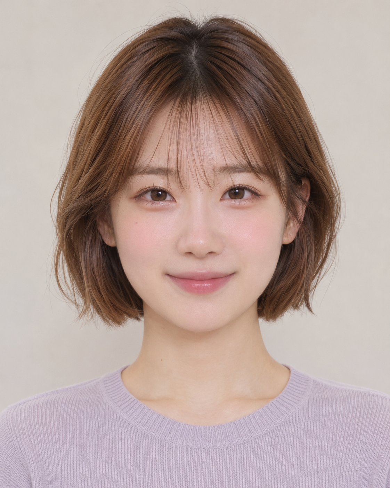
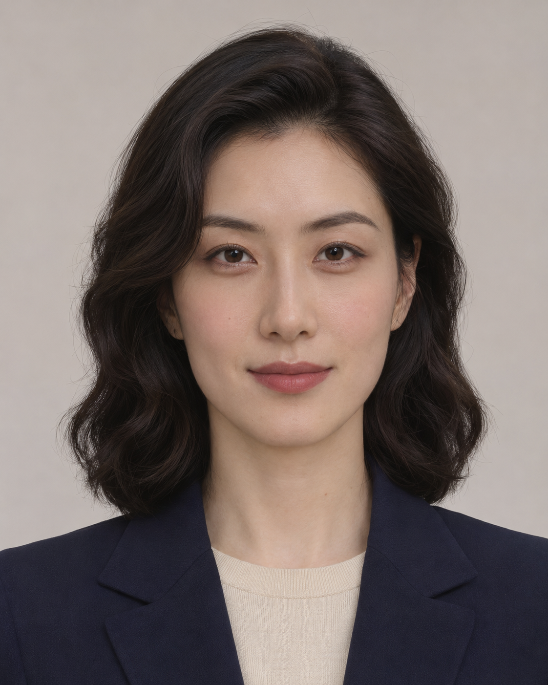
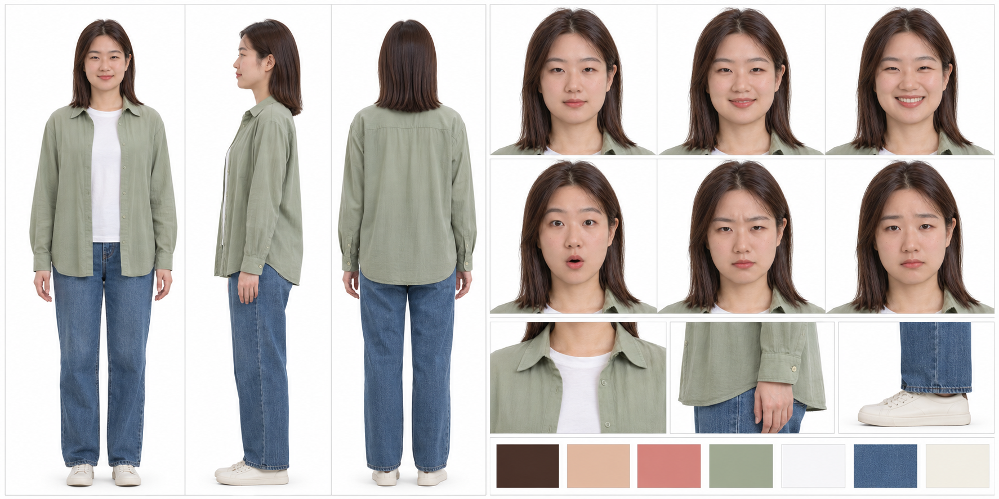
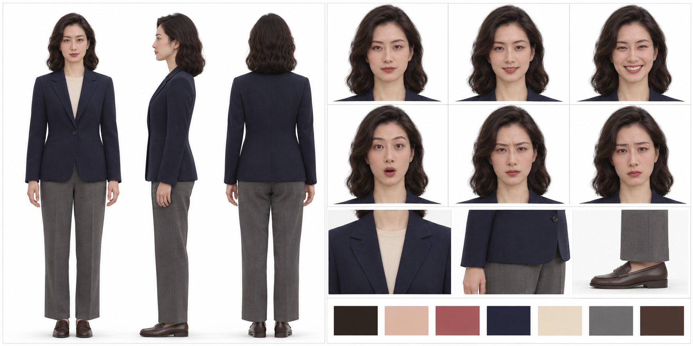

# AIGC Character Sheet

**Build distinctive, reusable characters for AI motion comics and virtual influencers (AI KOLs)—from a single face to a complete character sheet.**

**English** | [简体中文](README.zh-CN.md)

**Persona Blueprint · An AI skill that turns a portrait into a complete character reference sheet**

[](LICENSE)
[](SKILL.md)
[](https://github.com/taoxee/aigc-character-sheet/releases)

**AIGC Character Sheet** is an open-source **AI character design skill** for Codex, built for character development in **AI motion comics (manju / AI comic dramas)** and **AI KOL / virtual influencer production**. Design a distinctive face, get the user's approval, choose an outfit, and create a realistic **character reference sheet** with **front, side, and back views, six facial expressions, outfit details, and a color palette**. This visual foundation supports subsequent storyboarding, shot generation, and **AI video pre-production**. It supports facial structure design, makeup adapted to each face, and styles ranging from natural daily portraits to lightly retouched Korean/Japanese-inspired social portraits and vintage looks.

[Quick Start](#quick-start) · [Workflow](#workflow) · [Examples](#examples) · [Commercial Use](#license-and-commercial-use)



## What Is a Persona Blueprint?

A **Persona Blueprint** is a reusable visual specification for one character: an identity portrait, facial structure and features, makeup, a consistent outfit, and a final character reference sheet. It gives artists, prompts, and subsequent image generation a shared reference for the character's appearance.

The core deliverable is a complete **Character Sheet / Model Sheet** for a single character. Batch generation is optional, and a cute Korean/Japanese-inspired look is one available style.

## Workflow



1. **Face design:** Translate the desired personality and use case into facial structure, soft tissue, features, and makeup. Generate a clear identity portrait.
2. **Face approval:** Wait for approval of the actual image. If the user requests changes, revise the portrait before proceeding.
3. **Outfit reference:** Accept clothing images or an explicit instruction such as “no outfit reference” or “choose the outfit for me.” A missing attachment alone does not settle this choice.
4. **Final character reference sheet:** Use the selected portrait as an actual image input. Create consistent three-view full-body images, six expressions, clothing details, and a palette. Deliver the sheet and reusable records to complete the standard workflow.

When an outfit reference includes a person, use the clothing information without importing that person's face. Users may explicitly delegate selection; execution records must distinguish delegated choices from individual user approvals.

## Features

| Capability | Approach |
| --- | --- |
| **Facial structure design** | Design the brow and eye sockets, cheekbones, jaw and chin, and soft tissue separately. |
| **Distinct faces** | Compare every pair of characters across independent structural groups. Hair color, beauty marks, skin tone, and makeup do not count as structural differences. |
| **Makeup adaptation** | Place eyeshadow, eyeliner, blush, and lip makeup according to eyelids, brow-to-eye distance, cheeks, and lip shape. Supports subtle, everyday, and full makeup. |
| **Identity reference** | Use the selected character's actual portrait to guide facial proportions, base skin tone, identifying marks, and hairline in subsequent images. |
| **Character turnaround** | Show front, true 90-degree side, and back full-body views with compatible clothing construction, hairstyle, and body proportions. |
| **Expression sheet** | Include neutral, a small smile, joyful laughter, surprise, mild annoyance, and sadness through distinct facial muscle changes. |
| **Outfit breakdown** | Show relevant necklines, cuffs, hems, trouser or skirt construction, and footwear. Add equipment details when provided. |
| **Color palette** | Collect visual swatches for hair, skin, makeup, and clothing as references for later production. |
| **Clean photographic finish** | Control gray-brown mottling, repeated texture, excessive pores, and noise. Treat retouching strength separately from base skin tone. |

Characters are fictional adults by default. Identity portraits, front views, and expression close-ups use an **upright head and direct camera gaze**. Side and back views keep their true orientation. Final images default to **no visible text, handwritten signatures, logos, or watermarks**. Review each generated image against these requirements.

## Examples

These three independent fictional adult women demonstrate natural daily, soft social, and vintage styles. Each sheet used its own portrait as the identity input. They are different characters rather than before-and-after retouching comparisons of the same face.

| Natural Daily | Soft Social | Vintage |
| --- | --- | --- |
|  |  |  |
| Broader, softly squared face; slender eyes; restrained everyday makeup. | Short heart-oval face; open eyes; peach-rose makeup and a thin lip glaze. | Longer face; defined cheek and nose structure; adapted vintage lip makeup. |
| [Full character sheet](examples/01-natural/character-sheet.png) · [Prompts and design record](examples/01-natural/character.json) | [Full character sheet](examples/02-social/character-sheet.png) · [Prompts and design record](examples/02-social/character.json) | [Full character sheet](examples/03-vintage/character-sheet.png) · [Prompts and design record](examples/03-vintage/character.json) |

### Natural Daily Character Reference Sheet



### Vintage Character Reference Sheet



Original portraits are 1122 × 1402 pixels; sheets are 1774 × 887 pixels. Examples were generated with the built-in image tool and visually reviewed as still images. Restrained sadness and annoyance may need closer review for your intended use. Unseen side, back, and body details are design additions, not anatomy established by the frontal portrait. See the [example notes](references/public-examples.md) for execution records, reference inputs, and review scope.

## Quick Start

This Agent Skill packages `SKILL.md`, prompts, design rules, and examples. It requires an assistant environment that can read skills. Producing images also requires an available image generation or editing tool; without one, the workflow can provide complete prompts and design specifications.

The README is available separately in English and Chinese. Skill instructions, supporting references, and saved execution records are currently primarily in Chinese. You can request English prompts and responses when using the skill.

### Install with npx (Recommended)

Use the [Vercel Skills CLI](https://github.com/vercel-labs/skills) to install directly from GitHub. Run this in your project and choose your agent interactively:

```bash
npx skills add taoxee/aigc-character-sheet
```

For a Codex project installation:

```bash
npx skills add taoxee/aigc-character-sheet --skill aigc-character-sheet --agent codex
```

For a global Codex installation, add `--global`:

```bash
npx skills add taoxee/aigc-character-sheet --skill aigc-character-sheet --agent codex --global
```

Requires Node.js, npm (`npx`), and Git. Installation was verified with `skills@1.8.1` and Node.js `22.22.3`; that CLI release requires Node.js `>=22.20.0`. The CLI also supports other agents; only the Codex project installation has been tested for this skill. Image generation still requires an available image tool.

### Other Codex Installation Methods

Ask Codex:

```text
Use $skill-installer to install the skill from
https://github.com/taoxee/aigc-character-sheet
with the name aigc-character-sheet.
```

Or clone it into your personal skills directory:

```bash
mkdir -p ~/.agents/skills
git clone https://github.com/taoxee/aigc-character-sheet.git ~/.agents/skills/aigc-character-sheet
```

For a project-local installation, clone the same repository into `.agents/skills/aigc-character-sheet`. Codex discovers new skills automatically; restart if it does not appear. See the [official OpenAI skills documentation](https://learn.chatgpt.com/docs/build-skills) for discovery locations and invocation.

### Create Your First Character

```text
Use $aigc-character-sheet to design an original fictional adult woman
with a bright, lively personality for everyday vlog videos.
Choose a natural daily style and adapt the makeup to her facial structure.
First generate an upright, front-facing identity portrait with direct camera gaze.
Wait for my approval before continuing to clothing and the final character sheet.
Please write prompts and responses in English.
```

After approving the face:

```text
I approve this face. I have no outfit reference; please choose the clothing.
Create the final white-background character reference sheet with front, side,
and back views, six facial expressions, outfit details, and a color palette.
```

When uploading clothing:

```text
Use the approved portrait for identity and my uploaded image for clothing only.
Do not use the clothing model's face. Keep this character's identity and makeup.
```

## Use Cases

- **AI motion comics / AI comic dramas:** Establish a recurring cast's faces, expressions, and outfits before storyboarding and shot generation. Use each character sheet as a shared visual reference across episodes.
- **AI KOLs / virtual influencers:** Define a recognizable fictional digital creator for lifestyle posts, talking-head content, and brand storytelling, with identity and styling references for future content.
- **AI video pre-production:** Prepare identity and outfit references for vlogs, talking-head videos, short films, and fictional digital characters.
- **Character concept design:** Establish a specific character and hand off a visual specification to artists or subsequent generation steps.
- **Consistent character styling:** Reference the selected face while adjusting makeup, style, or clothing, keeping retouching separate from structural changes.
- **Character cast planning:** Design multiple structurally distinct characters when needed. A single character remains a complete task.

Available directions include Instagram-style lightly retouched portraits, natural realistic photography, Korean/Japanese-inspired social looks, and vintage character design. Choose style, makeup intensity, retouching strength, and base skin tone separately.

## FAQ

**Is this an AI character generator?**

It is a workflow skill for organizing AI character generation: design, prompts, reference image use, and checks. The repository contains no model weights, training dataset, or standalone image generation API.

**How do character reference sheets, model sheets, and expression sheets relate?**

The final sheet combines a character turnaround, an expression sheet, outfit details, and a palette into one visual reference. It does not directly produce a rigged 3D model or animation assets.

**Does it guarantee the same identity in every image?**

Actual portrait references help preserve identity, but results can vary across generations, angles, and video frames. The checker validates encoded design records, not image similarity or biometric identity. The public examples do not establish temporal consistency in video.

**Is it limited to women or cute styles?**

No. The examples feature adult women, while the workflow can design other fictional adults and styles according to the request. Light Korean/Japanese-style retouching and batch generation are optional.

**Can I use it commercially?**

The repository is MIT licensed, allowing commercial use, modification, and redistribution with the copyright and license notices retained. Image services and reference materials remain subject to their own terms and applicable rights. See the license section below.

## Repository

| Path | Purpose |
| --- | --- |
| [SKILL.md](SKILL.md) | Assistant entry point, workflow, and key generation constraints. |
| [references/character-structure.md](references/character-structure.md) | Facial structure and feature design. |
| [references/makeup-adaptation.md](references/makeup-adaptation.md) | Makeup placement adapted to the character's face. |
| [references/character-sheet.md](references/character-sheet.md) | Three-view, six-expression, detail, and palette template. |
| [references/workflow.md](references/workflow.md) | Face approval, clothing choice, and delivery-stage records. |
| [references/public-examples.md](references/public-examples.md) | Three portrait/sheet pairs, execution prompts, and review scope. |
| [scripts/check_design.py](scripts/check_design.py) | Read-only checks for encoded designs, distinct-face constraints, and workflow records. |
| [scripts/plan_cast.py](scripts/plan_cast.py) | Optional cast planner; does not call image generation tools. |
| [tests/test_design.py](tests/test_design.py) | Regression checks for design contracts and the planner. |

Run the existing checks without third-party Python dependencies:

```bash
python3 -m unittest discover -s tests -p 'test_*.py'
```

## License and Commercial Use

[MIT License](LICENSE). This covers the repository's code, prompts, documentation, and any rights the author can lawfully license in the self-generated examples. Commercial use, modification, distribution, and sublicensing are permitted with the copyright and license notices retained. MIT provides no guarantee of output exclusivity, non-infringement, or fitness for a particular purpose.

When generating images, follow the image model or platform's terms and the applicable rights in uploaded face, outfit, brand, or other reference materials. The AI examples depict fictional characters and do not grant rights to third-party materials.

Parts of the design rules, checker, and adapted prompt examples incorporate work from [nuyoah Portrait Character Designer](https://github.com/nuyoah-ai-works/nuyoah-portrait-character-designer). Its original MIT copyright and license are retained. See [THIRD_PARTY_NOTICES.md](THIRD_PARTY_NOTICES.md) and the [third-party MIT license](licenses/nuyoah-MIT.txt) for attribution and scope. Attribution in documentation is not an instruction to add signatures to images.

## Contributing

Use [GitHub Issues](https://github.com/taoxee/aigc-character-sheet/issues) to report identity consistency, makeup adaptation, or layout problems. Include the use case, prompt, permitted changes, and actual result where possible. Do not submit secrets or unauthorized private materials. Run the regression checks when changing checker scripts, and distinguish design intentions from observed image results.
