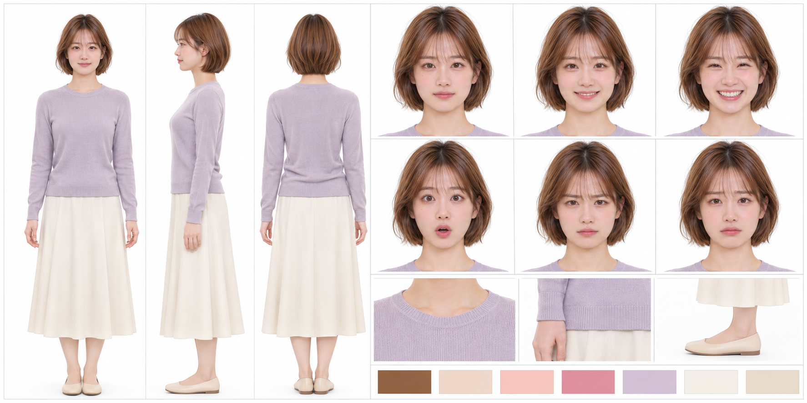
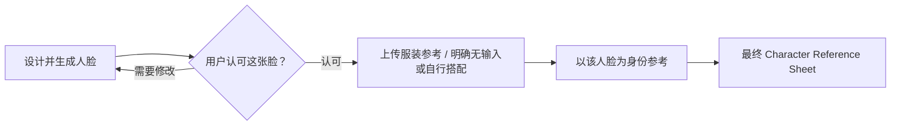
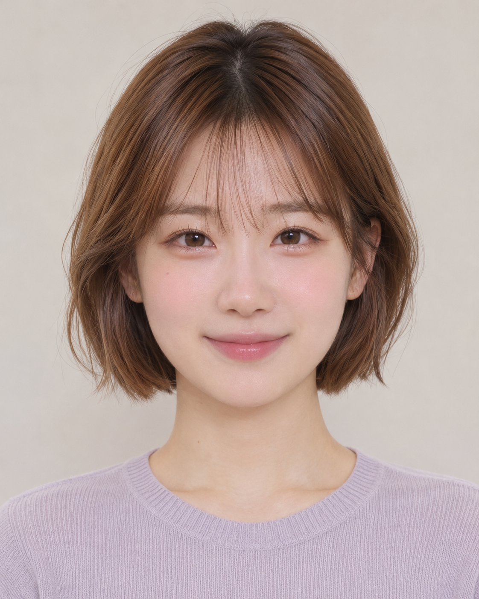
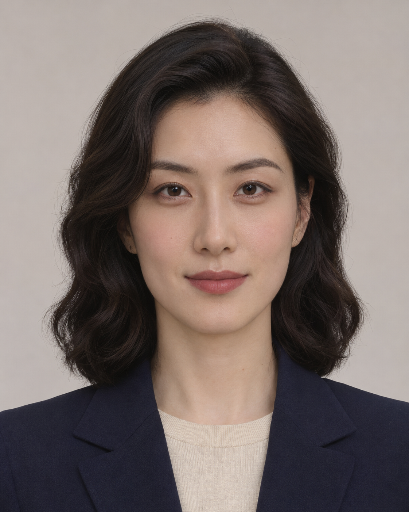
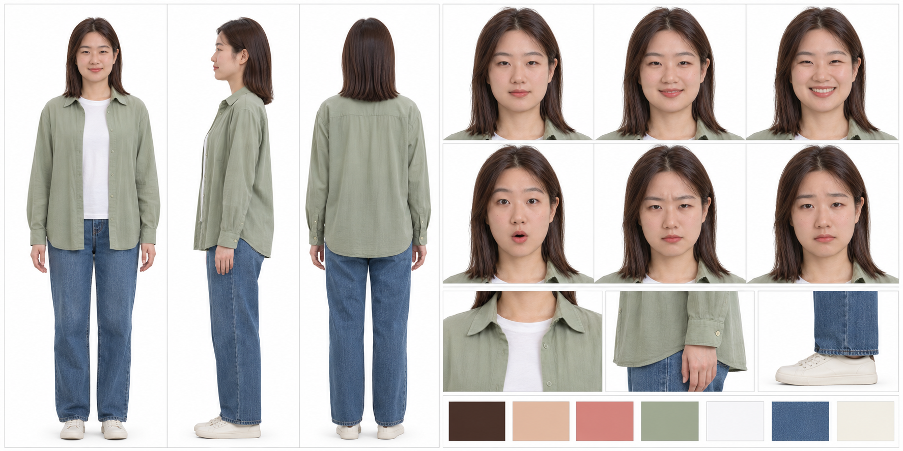
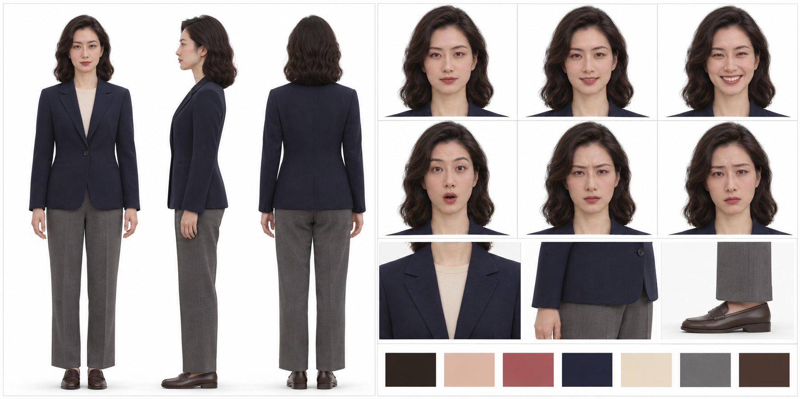

# AIGC Character Sheet

**从一张脸开始，为你的漫剧和 AI KOL 打造有辨识度、可持续复用的角色。**

[English](README.md) | **简体中文**

**Persona Blueprint · 从人脸设计到完整角色设定表的 AI Skill**

[](LICENSE)
[](SKILL.md)
[](https://github.com/taoxee/aigc-character-sheet/releases)

**AIGC Character Sheet** 是服务于**漫剧 / AI 漫剧**和 **AI KOL / 虚拟网红**角色设计与制作的开源 AI Skill：先设计具有辨识度的人脸，经过用户认可，再结合服装参考，制作包含**正面 / 侧面 / 背面三视图、六种面部表情、服装细节和配色板**的 Character Reference Sheet（角色设定表），为后续分镜、镜头生成与 AIGC 视频制作提供统一人物参考。支持骨相差异、脸型与妆容适配，以及自然日常、日韩轻修图、复古等多种风格。

[快速开始](#快速开始) · [工作流程](#工作流程从人脸到角色设定表) · [效果示例](#效果示例三种风格) · [商用许可](#开源与商用)



## Persona Blueprint 是什么？

在这个项目中，**Persona Blueprint** 指一份可以持续引用的人物视觉蓝图：人脸基准、骨相与五官特征、妆容设计、统一服装，以及最终角色设定表。它帮助后续创作保留具体人物的特征，也让美术、提示词和图像参考有共同依据。

核心交付是一位完整人物的 **Character Sheet / Model Sheet**。单个人物就能完成整个流程；批量生成是可选扩展，日韩可爱风也只是可选风格。

## 工作流程：从人脸到角色设定表



1. **Face Design / 人脸设计**：从气质与用途出发，分别确定骨相、软组织、眉眼鼻唇和妆容，生成清晰的人脸基准图。
2. **Face Approval / 人脸认可**：用户认可具体成图后再进入下一步；需要调整时先修改人脸。
3. **Outfit Reference / 服装参考**：上传服装图片，或明确说“无输入 / 你搭配”。没有上传附件不会自动被视为放弃服装选择。
4. **Character Reference Sheet / 最终设定表**：使用已选人脸作为真实图像参考，统一三视图、六表情、服装细节与配色。交付设定表及可复用记录后，标准流程结束。

服装参考图中即使有人，也只取服装信息，不把参考者的人脸混入角色。用户可明确委托助手代选；记录必须反映实际授权，不能把代选写成用户逐张认可。

## 人物设计能力

| 能力 | 具体做法 |
| --- | --- |
| **Facial structure · 骨相设计** | 分开设计眉骨 / 眼窝、颧部、下颌 / 下巴和软组织，避免只靠发型或滤镜制造人物差异。 |
| **Distinct faces · 不同脸检查** | 多人物设计逐对比较独立结构组；发色、痣、肤色和妆容不充当骨相差异。 |
| **Makeup adaptation · 妆容适配** | 根据眼睑、眉眼距离、颧部和唇形安排眼影、眼线、腮红与唇妆；支持淡妆、日常妆与浓妆。 |
| **Identity reference · 身份参考** | 已选人物的后续生成实际引用其图片，锁定五官、基础肤色、标记和发际线。 |
| **Character turnaround · 人物三视图** | 正面、真实 90° 侧面、背面全身视图；服装结构、发型和身体比例保持相容。 |
| **Expression sheet · 六表情** | 平静、浅笑、开心大笑、惊讶、轻微不满、难过，使用不同的面部肌肉变化。 |
| **Outfit breakdown · 服装细节** | 展示领口、袖口、下摆、裤裙结构和鞋款等必要细节；有设备参考时再补充设备。 |
| **Color palette · 配色板** | 提取头发、肤色、妆容和服装的视觉配色，便于后续制作参考。 |
| **Clean photographic finish · 干净写实质感** | 控制灰褐斑驳、重复纹理、过强毛孔和噪声；修图强度与基础肤色分别处理。 |

默认成年虚构人物。人脸基准、正面和表情特写保持**正头、直视镜头**；侧面和背面保持真实朝向。最终图片默认**无可见文字、无手写署名、无标志、无水印**。生成结果仍需逐张检查。

## 效果示例：三种风格

以下是三位独立成年虚构女性，分别展示自然日常、日韩轻修图和复古方向。每张设定表都以对应人脸图片作为身份输入；它们是不同人物，不是同一张脸的修图前后对比。

| 自然活力 · Natural Daily | 日韩轻甜 · Soft Social | 知性复古 · Vintage |
| --- | --- | --- |
|  |  |  |
| 较宽的方圆轮廓、细长眼型；清爽日常妆。 | 短心形椭圆轮廓、开放眼型；桃粉妆与薄唇釉。 | 偏长脸、较明确颧鼻层次；适配复古唇妆。 |
| [完整角色设定表](examples/01-natural/character-sheet.png) · [实际提示词与设计](examples/01-natural/character.json) | [完整角色设定表](examples/02-social/character-sheet.png) · [实际提示词与设计](examples/02-social/character.json) | [完整角色设定表](examples/03-vintage/character-sheet.png) · [实际提示词与设计](examples/03-vintage/character.json) |

### 自然日常



### 复古风格



原始人脸为 1122 × 1402，设定表为 1774 × 887。样例由内置图像工具生成，并经静态目视检查；难过与不满等克制表情的辨识度仍需结合用途判断。未知侧背和身体是设计补全，不能视为正面照片证实的真实结构。完整 prompt、参考输入关系与校验摘要见 [示例说明](references/public-examples.md)。

## 快速开始

这是包含 `SKILL.md`、提示词、设计规则与示例的 Agent Skill，不是独立的在线生图服务。需要能读取 skill 的助手环境；实际出图还需要可用的图像生成 / 编辑工具。缺少图像工具时，可以输出完整提示词与设计方案。

### 使用 npx 安装（推荐）

通过 [Vercel Skills CLI](https://github.com/vercel-labs/skills) 直接从 GitHub 安装。在项目目录运行下面的命令，交互选择使用的助手：

```bash
npx skills add taoxee/aigc-character-sheet
```

安装到 Codex 当前项目：

```bash
npx skills add taoxee/aigc-character-sheet --skill aigc-character-sheet --agent codex
```

全局安装到 Codex，增加 `--global`：

```bash
npx skills add taoxee/aigc-character-sheet --skill aigc-character-sheet --agent codex --global
```

需要 Node.js、npm（提供 `npx`）和 Git。本项目使用 `skills@1.8.1` 与 Node.js `22.22.3` 实测安装成功；该版本安装器要求 Node.js `>=22.20.0`。安装器也支持其他助手，本 skill 目前只实测了 Codex 项目级安装。实际出图仍需要可用的图像工具。

### Codex 的其他安装方式

可以直接在 Codex 中请求：

```text
使用 $skill-installer 从 https://github.com/taoxee/aigc-character-sheet 安装这个 skill，名称为 aigc-character-sheet。
```

也可以手动克隆到个人 skills 目录：

```bash
mkdir -p ~/.agents/skills
git clone https://github.com/taoxee/aigc-character-sheet.git ~/.agents/skills/aigc-character-sheet
```

项目内安装时，可将同一仓库克隆到 `.agents/skills/aigc-character-sheet`。Codex 会发现新 skill；若未显示，重启后再查看。目录与调用方式参考 [OpenAI 官方 Skills 文档](https://learn.chatgpt.com/docs/build-skills)。

### 第一次使用

```text
使用 $aigc-character-sheet，从零设计一位明亮活泼的成年虚构女性，
用于生活记录视频。自然日常风，妆容按她的脸型适配。
先生成正头、直视镜头的人脸，等我认可后再继续服装和最终角色设定表。
```

认可人脸后：

```text
这张脸可以。服装无输入，请你搭配。
继续生成白底 Character reference sheet：三视图、六表情、服装细节、配色板。
```

上传服装时：

```text
使用这张已认可的人脸，服装参考我上传的图片。
只参考服装，不参考穿衣者的脸；保持人物身份和妆容。
```

## 使用场景

- **漫剧 / AI 漫剧**：在分镜与镜头生成前，确定主角、配角的人脸、表情与服装，使用角色设定表作为跨镜头、跨集数的共同视觉参考。
- **AI KOL / 虚拟网红**：为生活记录、口播、社交内容和品牌叙事设计有辨识度的虚构数字人物，建立后续内容可引用的人物身份与造型依据。
- **AIGC 视频前期设计 / AI video pre-production**：为生活记录、日常口播、短片与虚构数字人物准备身份和服装参考。
- **角色概念设计 / Character concept design**：先确定一位具体人物，再向美术或后续生成环节交接视觉设定。
- **同人物换妆与造型 / Consistent character styling**：以选中人脸为参考，调整妆容、风格或服装，避免把修图当作改骨相。
- **多人阵容 / Character cast planning**：需要时设计多个结构不同的人物；单人设计仍是完整任务。

日韩网感、Instagram 风格的轻修图肖像、自然写实人像和复古人物设计都可作为方向。风格、妆容浓度、修图强度和基础肤色分别选择，不自动把所有人物变成同一类脸。

## 常见问题

**这是 AI character generator 吗？**

它是组织 AI 人物生成的工作流 skill，负责设计、提示词、参考图使用和检查。仓库不包含模型权重、训练数据集或独立生图 API。

**Character reference sheet、model sheet 和 expression sheet 有什么关系？**

本项目的角色设定表包含三视图（character turnaround）、六表情（expression sheet）、服装拆解和配色，是一份整合的视觉参考。它不直接输出可绑定的 3D 模型或动画资产。

**能保证一直是同一个人吗？**

使用实际人脸参考有助于保持身份，但不能保证每次生成、所有角度或视频帧都完全一致。检查脚本验证的是已编码设计记录，不进行图像识别或生物特征认证；当前公开示例也没有验证视频时间一致性。

**只支持成年女性或可爱风吗？**

不是。公开示例选择了成年女性，工作流可根据请求设计其他成年虚构人物和风格。日韩轻修图与批量生成均为可选能力。

**可以商用吗？**

本仓库按 MIT 许可发布，可商业使用、修改和分发，保留版权与许可声明即可。调用的图像服务及上传素材仍适用各自的条款和权利要求，详见下方许可说明。

## 文件说明

| 路径 | 用途 |
| --- | --- |
| [SKILL.md](SKILL.md) | 助手入口、工作流和关键生成约束。 |
| [references/character-structure.md](references/character-structure.md) | 人物骨相与五官结构设计。 |
| [references/makeup-adaptation.md](references/makeup-adaptation.md) | 根据人物结构适配妆容。 |
| [references/character-sheet.md](references/character-sheet.md) | 三视图、六表情、细节与配色模板。 |
| [references/workflow.md](references/workflow.md) | 人脸认可、服装选择和交付阶段记录。 |
| [references/public-examples.md](references/public-examples.md) | 三套人脸与设定表、实际提示词及检查范围。 |
| [scripts/check_design.py](scripts/check_design.py) | 只读检查设计记录、不同脸约束及阶段信息。 |
| [scripts/plan_cast.py](scripts/plan_cast.py) | 可选多人规划器，不调用生图工具。 |
| [tests/test_design.py](tests/test_design.py) | 设计合同与规划器回归检查。 |

运行已有检查，无第三方 Python 依赖：

```bash
python3 -m unittest discover -s tests -p 'test_*.py'
```

## 开源与商用

[MIT License](LICENSE)。许可范围包含本仓库的代码、提示词、文档，以及作者对自生成示例依法可以授予的权利；允许商业使用、修改、分发和再许可，须保留版权与许可声明。MIT 不构成对输出独占性、无侵权或任何特定用途适用性的保证。

实际生成图片时，仍需遵守所用图像模型 / 平台的服务条款，以及上传人脸、服装、品牌等参考素材的适用权利。仓库内的 AI 示例为虚构人物视觉设计，不是对第三方素材的授权。

部分结构、检查器与改写案例融合自 [南鸢·人像角色设定师](https://github.com/nuyoah-ai-works/nuyoah-portrait-character-designer)，原 MIT 版权与许可完整保留。具体来源、改动范围与示例来源见 [THIRD_PARTY_NOTICES.md](THIRD_PARTY_NOTICES.md) 和 [第三方 MIT 原文](licenses/nuyoah-MIT.txt)。文档归属声明不会作为图片中的署名。

## 反馈与改进

欢迎通过 [GitHub Issues](https://github.com/taoxee/aigc-character-sheet/issues) 提交人物一致性、妆容适配或版式问题。建议附上使用场景、提示词、允许变化项及实际结果；请勿提交密钥或未授权的私人素材。修改检查脚本时请运行上述回归检查，并明确区分文字设计目标与实际图像效果。
